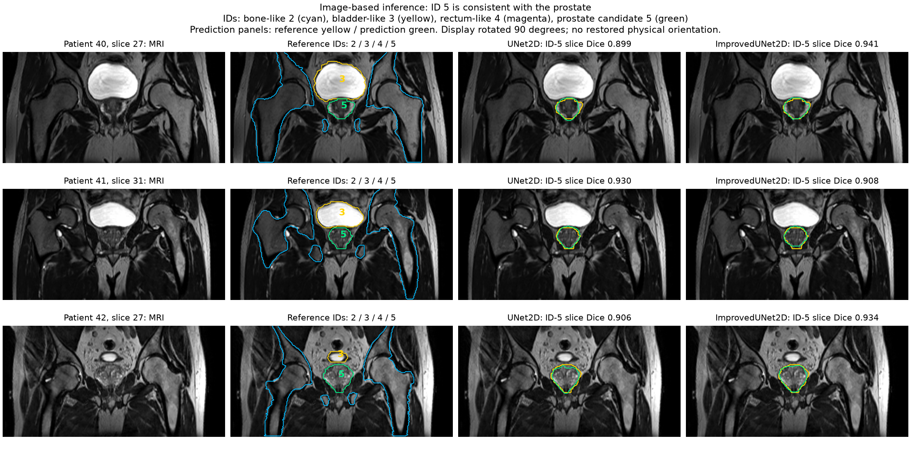
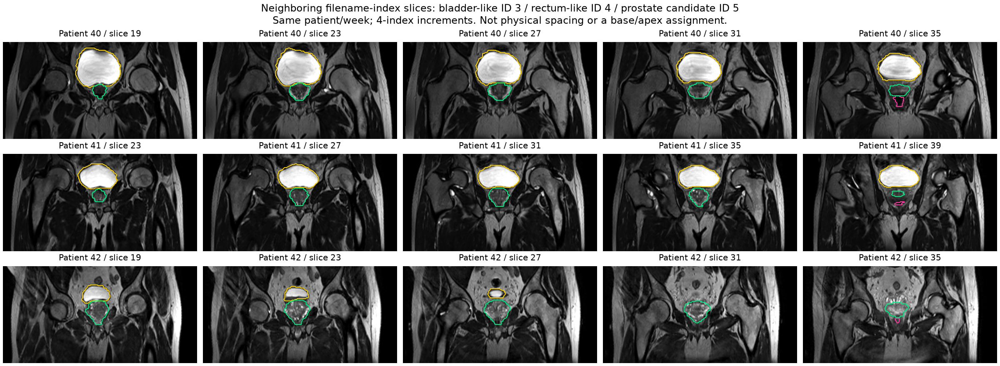

# Image-based prostate label interpretation

Updated 29 October 2026 after tutor feedback. **Conclusion: ID 5 is the image-based prostate interpretation.** This is an inference from the local MRI/reference/prediction evidence, not an official dataset dictionary or a tutor-confirmed numerical mapping.

## Identification method

The task is to associate a numeric segmentation ID with the visible organ. Dice measures overlap within an ID and cannot identify anatomy. The interpretation therefore uses original MRI appearance, reference-mask location/shape and consistency between neighboring slices and patients. ID 5 is not chosen because it has a convenient score or the largest improvement.

- ID 3 encloses a large bright fluid-filled, bladder-like central structure.
- ID 5 encloses a smaller, compact central gland-like region below that structure in the rotated display. It is not the broad body outline or paired/broad bony structure.
- ID 4 appears as a rectum-like region further posterior in the filename-index sequence, with overlap/adjacency to ID 5 in some images. The relative relationships are consistent with a prostate below the bladder and anterior to the rectum.
- The relationship is visible in patients 40, 41 and 42, with different organ shapes and bladder filling. Size alone, brightness alone or a single slice is insufficient.
- The primary anatomical references are the PI-RADS v2 anatomy discussion and an MRI anatomy study [1,2]. These describe anatomy but do not establish the course dataset's numeric dictionary.

Each main example is week 0's largest reference ID-5 cross-section for one test patient, with lowest filename slice index on ties. This selection is based on reference area for visibility, not prediction accuracy or improvement. The baseline and Improved predictions use the original frozen runtime and checkpoints, with the same z-score preprocessing. All three examples' pixel counts and selected input hashes are recorded in the evidence JSON. Patient 41's illustrated slice is a counterexample to uniform improvement.

The second figure shows offsets -8, -4, 0, +4 and +8 around each selected filename slice index. A separate profile records all 60 week-0 masks per patient (180 masks total). These are filename-index neighbors, not verified physical spacing. The image/mask affines match but are identity, and descriptions are empty; the display rotation does not restore physical patient orientation or prove base/apex positions. Some anatomical structures are absent from a given 2D plane.

## Consequence for the comparison

Under this interpretation, the prostate test result is the already measured ID-5 result: **Dice 0.803655 to 0.843050 (+3.939 percentage points)**; **IoU 0.671759 to 0.728683 (+5.692 pp)**. Both exceed the course's pooled test Dice target of 0.75. Whole-cohort ID-5 FP falls from 18,383 to 14,951 pixels, and FN falls from 7,357 to 5,394. Every patient's pooled ID-5 Dice improves, although individual slices can worsen.

This interpretation was made after the tutor discussion and after full testing. It changes the report's anatomical interpretation only. It does not remap labels, alter any metric CSV, change a trained weight or checkpoint, or train/tune on test results. The two illustrative models were reloaded for three images each, rather than rerunning the full test experiment. Independent anatomical review could revise the interpretation; all six numeric scores remain available for that reason.

Full reproducible record: [anatomy_evidence.json](results/anatomy_review/anatomy_evidence.json). All full-cohort numbers are from [the original pooled test CSV](results/test_local_705243/per_class_test.csv) and original evaluation records, not from averaging selected images.

## References and assistance

[1] ACR, ESUR and AdMeTech Foundation. PI-RADS v2 (2015), anatomy and Figure 1. https://pmc.ncbi.nlm.nih.gov/articles/PMC6467207/

[2] Normal anatomic relationship between urethral sphincter complex and zones of prostrate in young Chinese males on MRI (2015). https://pmc.ncbi.nlm.nih.gov/articles/PMC4659132/

Codex assisted with visual interpretation, plotting, illustrative fixed-weight inference, calculations and writing. The student remains responsible for checking and explaining the label inference. Raw NIfTI images and weights remain outside the revision's source files; rendered image derivatives follow the existing qualitative-report workflow.
