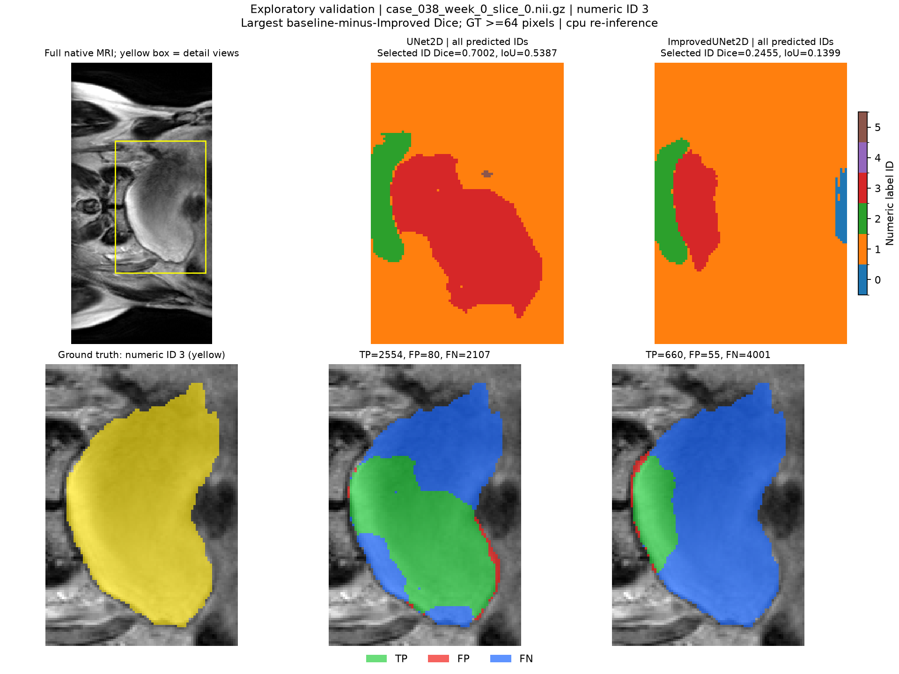
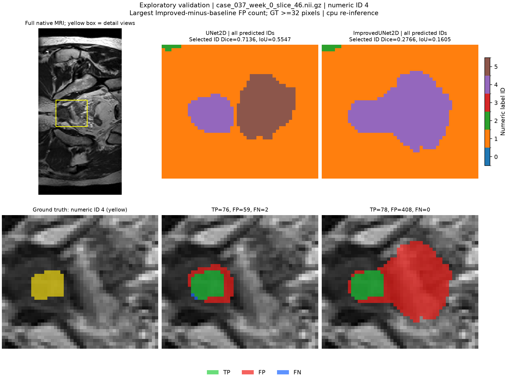
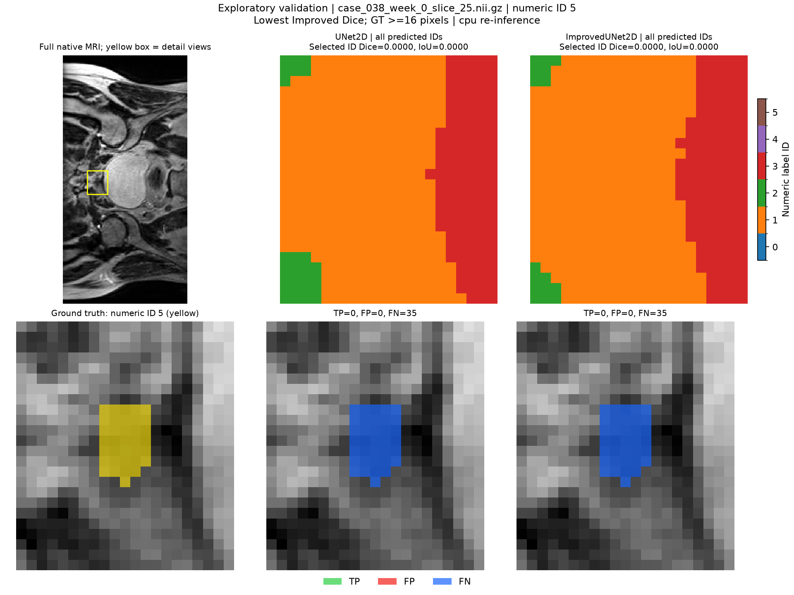
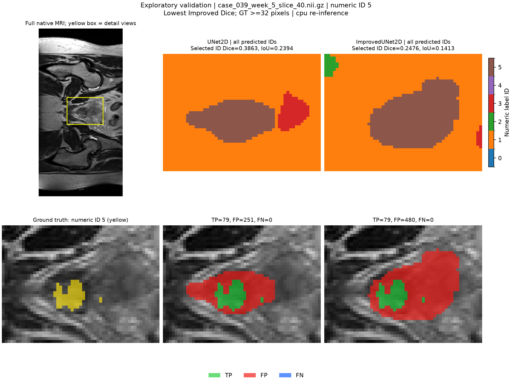
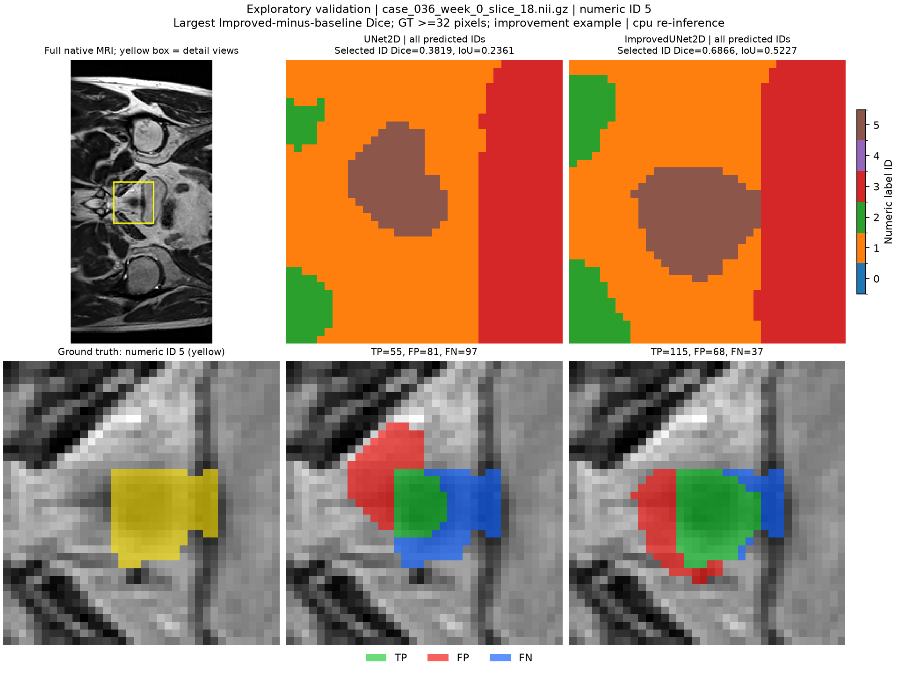

# Exploratory validation error analysis

Reviewed on 27 October 2026. Five real validation slices show four failure examples and one improvement example. All labels remain numeric because their anatomical mapping is unconfirmed. These are deliberately selected diagnostic examples, not a representative sample or held-out test evaluation. Overall scores remain in [VALIDATION_RESULTS.md](VALIDATION_RESULTS.md).

## Method and provenance

- Source runtime: frozen commit `bc8a6a4688f50770f71de24a56dff8aad43204c7`; selected checkpoints: baseline epoch 9 and Improved epoch 20, unchanged from the formal comparison.
- `failure_analysis.py` audits both completed runs, verifies matching protocol/source/data records and uses the frozen runtime files. It verifies checkpoint SHA256 before and after inference, selected image/mask affine agreement, recorded filename/size consistency, and selected input SHA256 stability.
- Five CPU re-inferences preserve the native 256x128 grids and saved all-pixel z-score preprocessing. MRI 1st-99th percentile clipping is only a display window; it does not modify the model inputs. Each full MRI has a yellow box showing the common detail-view crop, defined by the union of ground truth and both selected-label predictions plus eight pixels of margin, clipped to the grid.
- Upper prediction panels use the six-ID color bar. Lower overlays use green=TP, red=FP and blue=FN for the selected ID; the ground-truth detail view uses yellow. These two palettes serve different purposes. Display orientation is native array orientation, without an anatomical plane or base/apex assignment.
- All eight tests passed on Rangpur CPU (5.664 s), including five synthetic PNG exports and hand-checked inference counts. The real five-slice run then printed `Exploratory validation overlays: PASS`. The downloaded manifest reports completed, and source/PNG/checkpoint checksums passed local checks. All five figures were visually inspected.
- Figure counts/Dice/IoU use fresh CPU inference. Selected-label metrics match the CUDA reference in all five examples. Full six-label confusion-matrix difference flags occur for baseline example 3 and Improved examples 4 and 5; these flags are preserved in the manifest. This analysis is not a timing benchmark.
- Full selection rules, dataset indices, filenames, reference and rendered counts, crop bounds, hashes and difference flags are in [analysis_manifest.json](results/failure_analysis_704715/analysis_manifest.json).

## Declared selection rules

The rules were chosen post hoc to investigate patient/label findings in the validation comparison. Each search is within the named patient, uses validation pass 1, and breaks ties by the lowest dataset index. The minimum target size prevents selecting a completely absent target; it is not a clinically meaningful size threshold.

| Example | Patient / ID | Rule | Minimum GT pixels | Eligible slices |
|---|---|---|---:|---:|
| 1 | 38 / 3 | Largest baseline-minus-Improved Dice; GT >=64 pixels | 64 | 54 |
| 2 | 37 / 4 | Largest Improved-minus-baseline FP count; GT >=32 pixels | 32 | 15 |
| 3 | 38 / 5 | Lowest Improved Dice; GT >=16 pixels | 16 | 20 |
| 4 | 39 / 5 | Lowest Improved Dice; GT >=32 pixels | 32 | 154 |
| 5 | 36 / 5 | Largest Improved-minus-baseline Dice; GT >=32 pixels; improvement example | 32 | 28 |

## Displayed-label measurements

| Example | Ground-truth pixels | Baseline TP / FP / FN | Improved TP / FP / FN | Baseline Dice | Improved Dice |
|---|---:|---|---|---:|---:|
| 1 | 4661 | 2554 / 80 / 2107 | 660 / 55 / 4001 | 0.700206 | 0.245536 |
| 2 | 78 | 76 / 59 / 2 | 78 / 408 / 0 | 0.713615 | 0.276596 |
| 3 | 35 | 0 / 0 / 35 | 0 / 0 / 35 | 0.000000 | 0.000000 |
| 4 | 79 | 79 / 251 / 0 | 79 / 480 / 0 | 0.386308 | 0.247649 |
| 5 | 152 | 55 / 81 / 97 | 115 / 68 / 37 | 0.381944 | 0.686567 |

## 1. Broad missed region: patient 38, ID 3

File `case_038_week_0_slice_0.nii.gz`; dataset index 120; week 0; slice ID 0.

The ground-truth detail view contains a large connected ID-3 region. Both models miss part of it, but the Improved prediction covers a substantially smaller portion. Its blue FN overlay covers most of the target, with only a relatively small green TP patch. FN rises from 2,107 to 4,001 pixels while FP decreases only from 80 to 55; Dice falls from 0.700206 to 0.245536. This is a broad regional omission, beyond a small contour offset. It illustrates the patient-38 ID-3 decline in the aggregate results, without establishing its anatomical cause.

Human review should check target completeness, including large omitted regions, before accepting a contour. A future experiment could examine adjacent slices and multi-scale head behavior on validation data; this example alone does not prove that residual blocks or a specific head caused the failure.



## 2. Region expansion: patient 37, ID 4

File `case_037_week_0_slice_46.nii.gz`; dataset index 101; week 0; slice ID 46.

The yellow ground truth contains 78 pixels. The Improved model covers all 78 but also predicts a large contiguous surrounding region: FP increases from 59 to 408, and predicted ID-4 area expands from 135 to 486 pixels. The red FP overlay makes this expansion visible. Reducing FN from 2 to 0 does not compensate for the added false positives: Dice falls from 0.713615 to 0.276596.

Human review must check outward spread as well as missed area. Potential future checks include confusion with neighboring numeric IDs and validation-only changes to sampling/loss design; any such change requires a fresh protocol and cannot be credited to this completed comparison.



## 3. Complete small-region miss: patient 38, ID 5

File `case_038_week_0_slice_25.nii.gz`; dataset index 138; week 0; slice ID 25.

Both models produce no ID-5 pixels despite a 35-pixel ground-truth patch. Both have TP=0, FP=0, FN=35 and Dice=0. The blue overlay covers the entire yellow target region. Native-pixel enlargement makes this failure visible; no synthetic boundary smoothing or image resampling was used.

A high pooled score does not ensure recovery of every small visible region. Review should explicitly inspect small connected regions. Whether missing 3D context, low contrast or class imbalance contributes remains a hypothesis, not a conclusion from this image.



## 4. Excess predicted area despite complete coverage: patient 39, ID 5

File `case_039_week_5_slice_40.nii.gz`; dataset index 515; week 5; slice ID 40.

Both models cover all 79 target pixels (FN=0), but each extends beyond the ground truth. The Improved prediction has a larger elongated red FP region: FP rises from 251 to 480 and predicted area from 330 to 559 pixels. Dice drops from 0.386308 to 0.247649. Complete target coverage therefore coexists with a poor overlap score.

Review must compare the predicted extent with the reference boundary rather than checking coverage alone. A single postprocessing rule that trims all predictions could reduce FP here while worsening the omissions in examples 1 and 3; that tradeoff requires validation rather than an automatic global fix.



## 5. Improvement with remaining errors: patient 36, ID 5

File `case_036_week_0_slice_18.nii.gz`; dataset index 10; week 0; slice ID 18.

The Improved prediction covers more of the 152-pixel ground truth: TP increases from 55 to 115, FN falls from 97 to 37, and FP decreases from 81 to 68. Dice increases from 0.381944 to 0.686567. The green overlay expands into part of the region missed by the baseline, although residual red and blue regions remain.

This deliberately selected improvement example provides context for the pooled ID-5 gain. It does not establish consistent improvement across patients or remove the need to review the remaining boundary discrepancies.



## Engineering interpretation and limits

The engineering dilemma is whether the extra model complexity and resource cost produces contours that need less human correction. This validation run presents mixed evidence: larger omissions and expansions in some cases, a complete small-region miss in both models, and an improvement in another case. The model name, lower validation loss or high aggregate scores cannot replace image-level review. Anatomy is unverified, so these images cannot rank clinical severity or establish prostate base/apex accuracy.

The five examples are selected extremes, include correlated slices from four validation patients, and reuse one training seed. They cannot estimate error prevalence, confidence intervals or held-out generalization. Explanations such as low contrast, class imbalance or missing 3D context remain candidate explanations requiring further evidence. The fixed-model local held-out evaluation has since completed (see [TEST_RESULTS.md](TEST_RESULTS.md)); sourced anatomical mapping remains outstanding; the tutor feasibility check-off is still pending.

## Reproduce

```bash
python -m unittest -v test_failure_analysis
python failure_analysis.py \
  --baseline-run "$HOME/hipmri_runs/comparison_v1_704715_0_UNet2D" \
  --improved-run "$HOME/hipmri_runs/comparison_v1_704715_1_ImprovedUNet2D" \
  --output-dir "$HOME/hipmri_runs/failure_analysis_704715_reproduced" \
  --device cpu
```

Use a new output directory and retain the frozen runtime snapshot, original checkpoints and supplied validation data. Outputs are five derived PNG figures and a JSON manifest; raw MRI/NIfTI data and checkpoint weights remain outside Git.

AI assistance covered deterministic example-selection and rendering code, test scaffolding, consistency checks, visual review and drafting this analysis. The student executed the commands and shared the results/files. The student remains responsible for checking and explaining the implementation, observations and limitations.
