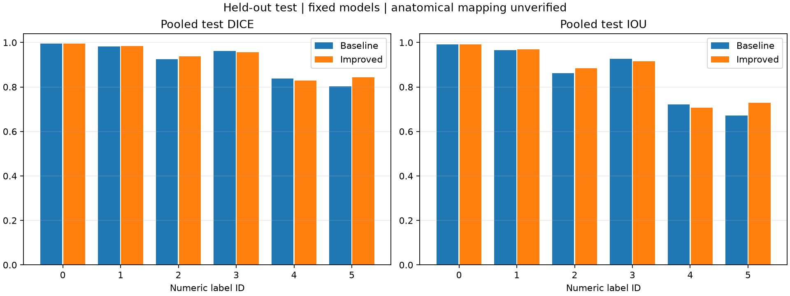
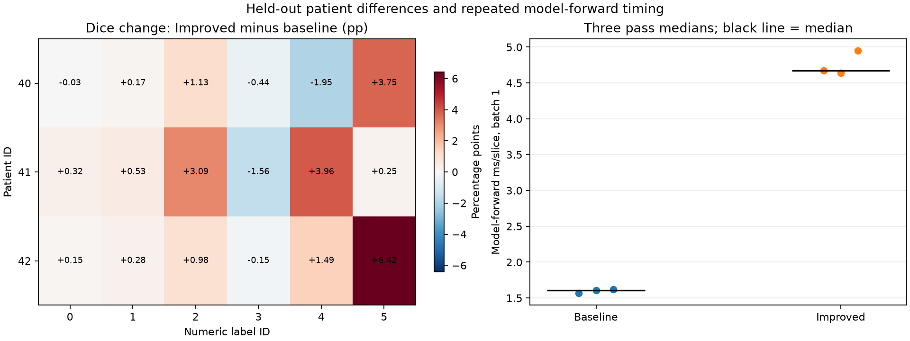

# Full held-out test results on the local GPU

**29 October tutor revision:** check-off completed as reported by the student; image-based analysis supports prostate = ID 5. Its test Dice improves from **0.803655 to 0.843050 (+3.939 pp; 4.90% relative gain)**. FP falls 18,383 to 14,951, FN falls 7,357 to 5,394. The anatomy inference and direct comparison are illustrated in [README](README.md) and [the label analysis](ANATOMICAL_LABEL_ANALYSIS.md). Original full-test metrics are unchanged.

Both validation-selected models completed three full test passes on all 540 supplied test slices, using the same fixed weights and original evaluator source. The local run printed `Local fixed-model full held-out test comparison: PASS`; completed provenance, grouped metrics, input/source/weight consistency, repeated predictions and every CSV cell passed the saved-record audit. Both figures were visually checked.

## Scope and provenance

- Test cohort: patients 40, 41 and 42; 540 slices, nine patient/week cases, all native 256x128. Patient 40 contributes 420 slices (77.78%); patients 41 and 42 contribute 60 each.
- Model source: `bc8a6a4688f50770f71de24a56dff8aad43204c7`; selected epochs baseline 9 / Improved 20, unchanged after validation. The checkpoint SHA256 values match the predeclared held-out protocol.
- Execution: Windows 11, Python 3.12.14, PyTorch 2.14.0+cu130 / CUDA build 13.0, RTX 4070 Laptop GPU (8188 MiB, driver 617.42). Local protocol `hipmri-heldout-numeric-local-v1` preserves the original full test procedure while documenting the user-requested hardware/path change.
- The original A100 held-out runner was committed as `bc601d92de5fb3da982b43d96de34afcd544a94c`. The local orchestration is identified by its exact source SHA256, not a fabricated Git commit. Actual execution logs/records remain in the local evidence directory.
- The downloaded accounting records show remote job 705243 already COMPLETED / 0:0 before the attempted cancellation. Its result files were not collected or reviewed. All numerical results here come from the separately executed local GPU run.
- All 1,080 local test image/mask files were content-hashed and rechecked around the evaluation stages. The transferred archive SHA256 matched the value printed on Rangpur. Patient separation from both training and validation passed.
- Numeric IDs 0-5 are preserved. This revision interprets ID 5 as prostate from image evidence and reports its task-specific comparison above; the student reports tutor feasibility check-off completed on 29 October.

## Pooled overlap

Confusion counts are summed over the full cohort before overlap is computed. Changes are Improved minus baseline in percentage points (pp).

| ID | Baseline Dice | Improved Dice | Dice change (pp) | Baseline IoU | Improved IoU |
|---|---:|---:|---:|---:|---:|
| 0 | 0.995656 | 0.995920 | +0.026 | 0.991349 | 0.991873 |
| 1 | 0.982035 | 0.984254 | +0.222 | 0.964704 | 0.968997 |
| 2 | 0.925427 | 0.938640 | +1.321 | 0.861204 | 0.884376 |
| 3 | 0.962184 | 0.956143 | -0.604 | 0.927123 | 0.915971 |
| 4 | 0.838244 | 0.827911 | -1.033 | 0.721531 | 0.706355 |
| 5 | 0.803655 | 0.843050 | +3.939 | 0.671759 | 0.728683 |

The descriptive mean over all six pooled-label Dice values is **0.917867 baseline versus 0.924320 Improved** (+0.645 pp). IDs 0, 1, 2 and 5 improve; IDs 3 and 4 decline. This all-ID mean is a secondary descriptive summary; the image-based ID-5 target comparison is reported separately. Neither establishes statistical/clinical superiority.

## Patient differences and aggregation

Each patient receives equal weight in the following per-label mean; all three patients have defined values. The cohort has only three independent patient IDs.

| ID | Baseline equal-patient Dice | Improved equal-patient Dice | Change (pp) |
|---|---:|---:|---:|
| 0 | 0.994015 | 0.995461 | +0.145 |
| 1 | 0.980949 | 0.984218 | +0.327 |
| 2 | 0.921972 | 0.939292 | +1.732 |
| 3 | 0.957475 | 0.950309 | -0.717 |
| 4 | 0.856776 | 0.868462 | +1.169 |
| 5 | 0.804542 | 0.839268 | +3.473 |

ID 3 declines for all three patients. ID 5 improves for all three, but the gain varies from about +0.250 pp for patient 41 to +6.418 pp for patient 42. For ID 4, pooled Dice falls while the equal-patient mean increases: patient 40 declines (0.829432 to 0.809963) and contributes most slices, while patients 41 and 42 improve. Pooled and patient-mean metrics answer different questions; neither should be chosen post hoc to hide a decline.

## Local timing

| Measurement | Baseline | Improved |
|---|---:|---:|
| Median of three model-forward pass medians, ms/slice | 1.605100 | 4.674550 |
| Three pass medians, ms | 1.568750, 1.605100, 1.617400 | 4.674550, 4.640200, 4.947650 |
| Median case-processing seconds (27 case/pass records per model) | 0.335762 | 0.545410 |

Improved model-forward time is **2.912x** baseline on this local GPU. Batch size is 1 with three warmups per shape and CUDA synchronization. Forward time excludes loading, preprocessing, transfers, argmax and metric computation. Case processing includes loading, preprocessing, transfers, forward and metrics, while excluding warmups/exports; each case has 60 slices. The recorded evaluation/export wall time was 59.613 seconds, excluding dependency installation, transfer and initial preflight audits.

Both local forward summaries are below the proposed 100 ms per-slice target in this measured scope. They do not measure a complete interactive contouring workflow. A100 validation latency is a separate experiment and must not be combined with these RTX 4070 timings as a same-device benchmark. No local whole-device training-memory bound was measured.

## Interpretation and limits

The fixed-model test run shows a modest all-ID mean gain with specific regressions and higher forward cost. The ID-3 decline appears in both validation and test. The results do not support an unconditional recommendation to replace the baseline. The image-based ID-5 interpretation allows a task-specific coursework comparison, with its inference limits stated above. The existing five qualitative failure examples remain validation examples; new anatomy illustrations are explicitly post-hoc test images and are not used for model tuning.

The same weights were reused in all three passes. These are repeat timing checks, not three training seeds, confidence intervals or independent replications. Test results were not used to retrain, tune, choose thresholds or change checkpoints. A new model-development study would require a separate evaluation design.

## Machine-readable evidence

- [Pooled class CSV](results/test_local_705243/per_class_test.csv), [patient CSV](results/test_local_705243/patient_test_metrics.csv), [equal-patient means](results/test_local_705243/equal_patient_mean_test.csv).
- [Model timing CSV](results/test_local_705243/model_test_summary.csv), [case timings](results/test_local_705243/case_test_times.csv), [full summary](results/test_local_705243/summary.json).
- [Audit record](results/test_local_705243/audit.json), [execution provenance](results/test_local_705243/provenance.json), [environment](results/test_local_705243/environment.json), [protocol](results/test_local_705243/protocol.json), [original protocol](results/test_local_705243/parent_protocol.json).
- [Test file content hashes](results/test_local_705243/test_content_sha256.json) and [exact executed local wrapper](results/test_local_705243/run_local_heldout.py.txt). The wrapper snapshot is workspace evidence with recorded paths, not a standalone project CLI; portable evaluator commands are in [REPRODUCIBILITY.md](REPRODUCIBILITY.md).

AI assistance covered local environment setup, transfer instructions, guarded extraction/orchestration, actual local command execution, numerical and source/data checks, figure review, and drafting this report. The student supplied the inputs from Rangpur and remains responsible for reviewing and explaining the submitted work.
