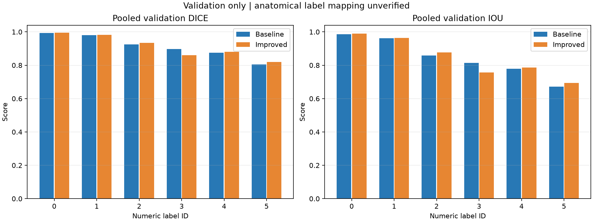
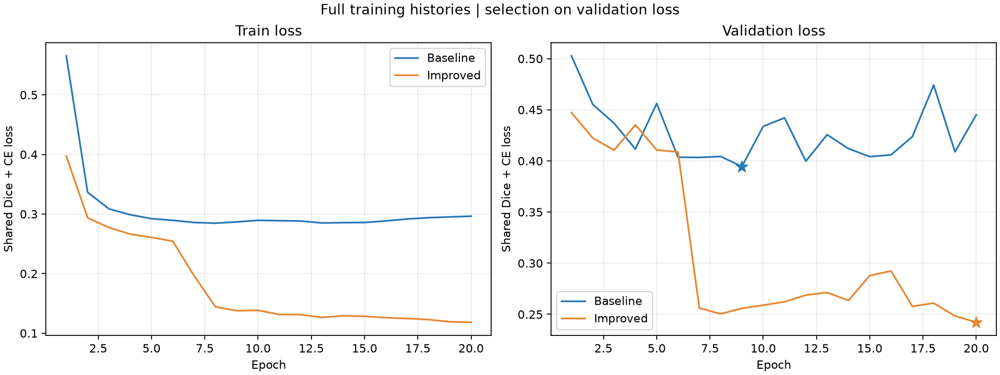
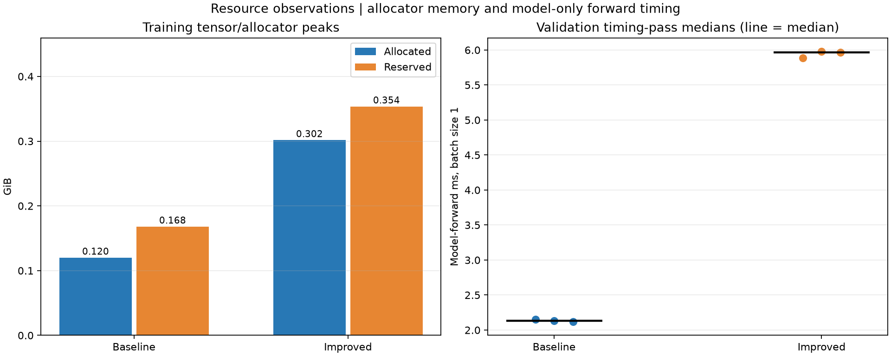

# Matched full-training validation results

Reviewed on 27 October 2026. Both models completed the frozen 20-epoch protocol and three full validation passes. Results are mixed: five numeric-label pooled Dice scores increased, but label 3 declined; the six-label mean is slightly lower for the Improved model. The Improved model also used more allocator memory and had a longer model-forward time. This experiment does not establish overall superiority or prostate-specific test accuracy.

## Protocol and evidence

- Protocol: `hipmri-2d-comparison-v1`; source commit `bc8a6a4688f50770f71de24a56dff8aad43204c7`.
- Reporting implementation: commit `6b63092`. Exported source/manifest/checkpoint hashes and reviewed result summaries are in [summary.json](results/comparison_v1_704715/summary.json).
- Models: UNet2D (1,962,422 parameters) and ImprovedUNet2D (3,187,746 parameters), base width 16, six output IDs. This compares whole architectures, not isolated feature ablations.
- Both use 20 epochs, batch size 2, Adam learning rate 0.001, seed 3710, the same paired flips, per-slice all-pixel z-score normalization, Dice plus cross-entropy, and native-shape batching.
- Each epoch covers 11,460 training slices / 31 patients and 660 validation slices / 4 patients. Patient separation passed. Evaluation covers 11 patient/week cases. Test images are not accessed by this comparison.
- Each model selects the minimum full-validation loss checkpoint (earliest tie). Selection epochs were baseline 9 and Improved 20; no checkpoint was selected by an individual label score.
- Both array tasks completed with Slurm exit code 0:0 and final task PASS markers. Baseline task 704715_0: a100-8, 49:05 elapsed. Improved task 704715_1: a100-1, 1:02:42 elapsed.
- The Improved task initially waited with `QOSMaxJobsPerUserLimit`; it started after the baseline finished.
- Saved-record audits passed for both downloaded runs. The local recomputation matched all downloaded comparison fields except relocated input paths; all four CSVs matched their JSON values. Three report figures were visually reviewed.

## Pooled numeric-label overlap

Each Dice/IoU value below is recomputed from the confusion matrix summed over all 660 validation slices. Changes are Improved minus baseline in percentage points (pp). Numeric IDs remain unassigned to anatomy.

| ID | Baseline Dice | Improved Dice | Dice change (pp) | Baseline IoU | Improved IoU | IoU change (pp) |
|---|---:|---:|---:|---:|---:|---:|
| 0 | 0.993030 | 0.994407 | +0.138 | 0.986156 | 0.988876 | +0.272 |
| 1 | 0.980363 | 0.981791 | +0.143 | 0.961482 | 0.964233 | +0.275 |
| 2 | 0.924195 | 0.934221 | +1.003 | 0.859073 | 0.876562 | +1.749 |
| 3 | 0.897304 | 0.861016 | -3.629 | 0.813737 | 0.755951 | -5.779 |
| 4 | 0.875168 | 0.880611 | +0.544 | 0.778044 | 0.786688 | +0.864 |
| 5 | 0.804001 | 0.819091 | +1.509 | 0.672242 | 0.693610 | +2.137 |

The unweighted mean of these six pooled-label Dice values is **0.912343 baseline versus 0.911856 Improved**. This descriptive mean includes every numeric ID; it is not a tutor-confirmed primary prostate metric. Label 3 loses 3.629 pp while label 5 gains 1.509 pp and label 2 gains 1.003 pp.



Full precision: [per-class CSV](results/comparison_v1_704715/per_class_comparison.csv).

## Patient differences

Patient 39 contributes 480/660 slices (72.73%); each other patient contributes 60. The following table first computes a Dice value per patient and then averages the four patient values equally. It complements the pooled values above rather than replacing them.

| ID | Baseline patient-mean Dice | Improved patient-mean Dice | Change (pp) |
|---|---:|---:|---:|
| 0 | 0.993050 | 0.994321 | +0.127 |
| 1 | 0.972599 | 0.972500 | -0.010 |
| 2 | 0.922124 | 0.928116 | +0.599 |
| 3 | 0.901070 | 0.855549 | -4.552 |
| 4 | 0.866387 | 0.863876 | -0.251 |
| 5 | 0.765095 | 0.792361 | +2.727 |

- Patient 38, label 3: Dice **0.795200 -> 0.611632** (-18.357 pp). This is the largest patient/label decline and needs image-level error analysis.
- Patient 37, label 4: **0.856800 -> 0.786273** (-7.053 pp), despite the small pooled label-4 improvement.
- Patient 36, label 5: **0.772585 -> 0.894256** (+12.167 pp). The pooled label-5 gain is not an improvement for every patient; patients 38 and 39 slightly decline.
- These observations informed four actual failure examples and one improvement example, now documented with MRI, ground truth, predictions and TP/FP/FN overlays in [ERROR_ANALYSIS.md](ERROR_ANALYSIS.md). Anatomical mapping remains unverified.

All patient/label values: [patient metrics CSV](results/comparison_v1_704715/patient_metrics_comparison.csv).

## Loss histories and checkpoint choice

| Measurement | Baseline | Improved |
|---|---:|---:|
| Selected epoch | 9 | 20 |
| Minimum validation CE + soft-Dice loss | 0.394608332 | 0.242225716 |
| Final epoch validation loss | 0.445130924 | 0.242225716 |

The baseline improves early and then its validation loss fluctuates. The Improved loss decreases sharply around epochs 7-8 and reaches its minimum at the final budgeted epoch; convergence beyond this fixed budget is not established. The objective uses cross-entropy and soft Dice, while the reported overlap uses hard argmax predictions. A lower objective therefore does not guarantee higher hard Dice for every label or patient.



## Runtime and memory

| Measurement | Baseline | Improved | Improved / baseline |
|---|---:|---:|---:|
| Peak allocated training GiB | 0.119952 | 0.301517 | 2.514x |
| Peak reserved training GiB | 0.167969 | 0.353516 | 2.105x |
| Training wall seconds including I/O and plots | 2904.286 | 3718.456 | 1.280x |
| Median of three model-forward pass medians, ms/slice | 2.134302 | 5.968241 | 2.796x |

Both nodes reported NVIDIA A100-PCIE-40GB, PyTorch 2.14.0+cu130 / CUDA build 13.0. Hardware nodes differ, and timing is observational rather than a controlled same-device benchmark. Each validation pass processes all 660 slices at batch size 1 after three shape-specific warmups, with CUDA synchronization around the model forward. Data loading, preprocessing, host-to-device transfer and metric computation are outside that forward timer.

- Baseline forward medians: 2.150752, 2.134302, 2.117505 ms.
- Improved forward medians: 5.886407, 5.979868, 5.968241 ms.
- These repeat measurements reuse the same weights; they are not three independent training seeds or confidence intervals.
- Both measured model-forward summaries are below the proposed 100 ms limit for this validation input shape. This does not establish complete application or held-out latency.
- Allocated/reserved peaks describe PyTorch training tensors and its allocator. They do not verify the proposed whole-device 12 GiB VRAM bound.
- Per-case times include loading, preprocessing, transfers, inference and metrics, excluding warmups and exports. Across 11 cases x 3 passes, median case processing time is 0.358803 s baseline and 0.577163 s Improved; each case contains 60 slices. These are not model-only per-slice times.



Full precision: [model summary](results/comparison_v1_704715/model_summary.csv) and [case times](results/comparison_v1_704715/case_times.csv).

## Reproduction and remaining work

Run from the project checkout with the original completed experiment directories available:

```bash
python compare_results.py \
  --baseline-run "$HOME/hipmri_runs/comparison_v1_704715_0_UNet2D" \
  --improved-run "$HOME/hipmri_runs/comparison_v1_704715_1_ImprovedUNet2D" \
  --output-dir "$HOME/hipmri_runs/comparison_report_704715_reproduced"
```

Use a new output directory. The original committed runtime snapshot and protocol must be preserved. The committed summaries/CSVs/PNGs contain derived validation records; MRI data and checkpoint weights remain outside Git.

The test set remains untouched by the comparison runner. Sourced label anatomy and tutor feasibility check-off remain outstanding. The fixed-model local held-out evaluation has since completed; see [TEST_RESULTS.md](TEST_RESULTS.md). Four actual validation failures and one improvement example have since been rendered and reviewed; see [ERROR_ANALYSIS.md](ERROR_ANALYSIS.md) for the declared selection rules, evidence and limitations. Four validation patients and one training seed limit generalization claims; no statistical or clinical superiority is established. Source and filename/size hashes support record consistency but do not prove byte-identical data contents. The initial validation bundles excluded weights, so their local audit checked saved records rather than re-running validation. Both original checkpoints were later downloaded, verified and reloaded for the separate local held-out test.

AI assistance covered report-code scaffolding, command suggestions, numerical consistency checks, plot review and drafting this analysis. The student executed the commands and shared the outputs and files; the student remains responsible for reviewing, understanding and explaining the submitted work.
